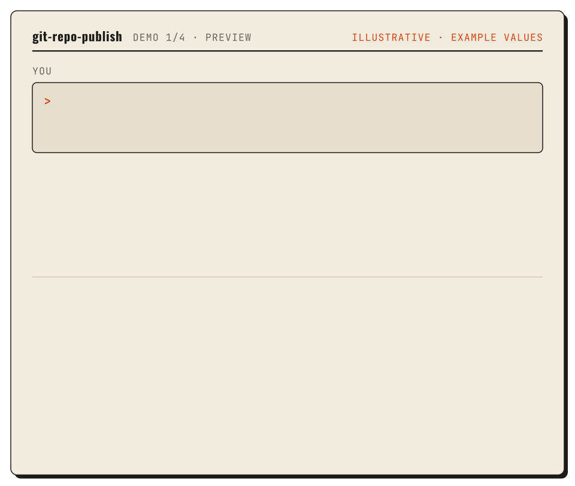
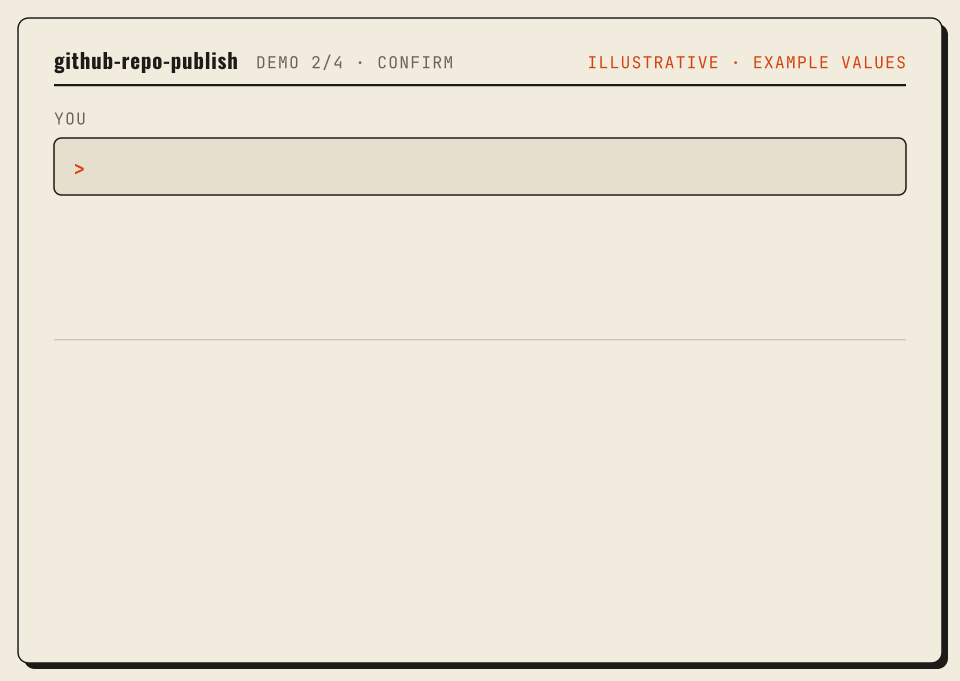
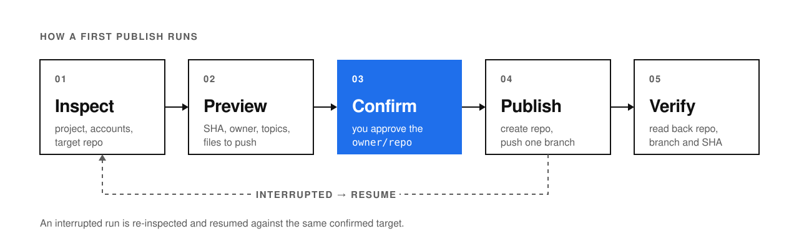
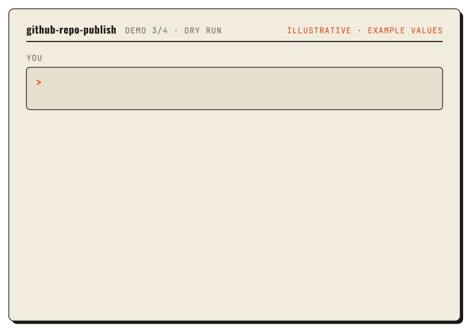
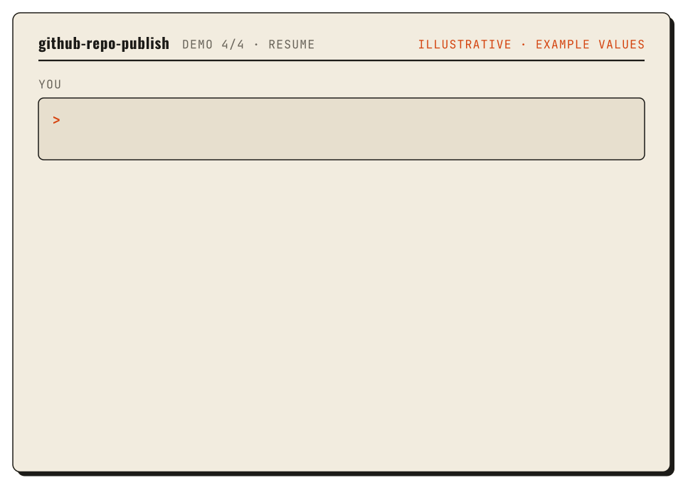

**English** · [简体中文](README.zh-CN.md)

# git-repo-publish

An [Agent Skill](https://agentskills.io/specification) for publishing a local Git project to GitHub or Alibaba Cloud Codeup for the first time.

<picture>
  <source media="(prefers-color-scheme: dark)" srcset="assets/readme/en/publish-preview-dark.svg">
  
</picture>

[Install](#install) · [First publish](#use) · [How it works](#how-it-works) · [Codeup](#codeup-configuration) · [Requirements](#requirements) · [MIT License](LICENSE)

## Install

The latest Skills CLI requires Node.js 22.20 or newer and npm.

```sh
npx skills add \
  byteee-com/git-repo-publish-skill \
  --skill git-repo-publish --global
```

Choose your agent when prompted. `--global` makes the skill available across projects. Omit it to install in the current project. [Skills CLI options](https://github.com/vercel-labs/skills/blob/main/docs/commands.md#skills-add)

<details>
<summary>How to invoke the skill by client</summary>

| Client | How to invoke the skill |
| --- | --- |
| [Codex](https://learn.chatgpt.com/docs/build-skills) | Type `$git-repo-publish` in chat |
| [Claude Code](https://code.claude.com/docs/en/skills) | Enter `/git-repo-publish` |
| [Cursor](https://cursor.com/docs/skills) | Type `/` in Agent chat and select `git-repo-publish` |
| [Gemini CLI](https://geminicli.com/docs/cli/skills/) | Check `/skills list`, then ask Gemini to use `git-repo-publish` |
| [OpenCode](https://opencode.ai/docs/skills/) | Ask OpenCode to use `git-repo-publish` |

</details>

## Use

### Connect GitHub

On a fresh machine, run the command below and follow the prompts to create or upload an SSH public key. Then check that GitHub greets you with the account you intend to publish from. [GitHub CLI login](https://cli.github.com/manual/gh_auth_login) · [Test your SSH connection](https://docs.github.com/en/authentication/connecting-to-github-with-ssh/testing-your-ssh-connection)

```sh
gh auth login --hostname github.com --web --git-protocol ssh
ssh -T git@github.com
```

On the first SSH connection, compare the host key fingerprint with GitHub’s published fingerprint before accepting it. [GitHub SSH key fingerprints](https://docs.github.com/en/authentication/keeping-your-account-and-data-secure/githubs-ssh-key-fingerprints)

If SSH already works and you only need to sign in to `gh`, use `gh auth login --hostname github.com --web --skip-ssh-key`. If you use multiple accounts, tell the skill which account and existing SSH host alias to use. The skill checks that the SSH identity matches the selected account before publishing. You can also explicitly choose HTTPS. [GitHub operations guide](references/github.md)

### Preview and confirm

Open the project in your agent and ask it to prepare the publish.

```text
Use git-repo-publish to preview publishing this project. Suggest a description and topics, let me choose the owner and repository name, and wait for my confirmation.
```

The skill uses the client's native question interface when available. For example, Codex can use structured questions and Claude Code can use `AskUserQuestion`. In a chat-only client, the same choices appear as text. The website is optional, and the complete preview is shown before you confirm the publish.

Review the account, destination, visibility, branch, and files or commit. A new GitHub repository defaults to **private**, with **SSH** for the push. Confirm using the actual target from the preview.

```text
Confirm publish to owner/repo
```

<details>
<summary>See the preview and confirmation demos</summary>

These examples use sample repository names and commit SHAs. The preview shows the optional HTTPS transport. [Static versions](assets/readme/demo/)

<picture>
  <source media="(prefers-color-scheme: dark)" srcset="assets/readme/demo/gif/preview-dark.gif">
  
</picture>

<picture>
  <source media="(prefers-color-scheme: dark)" srcset="assets/readme/demo/gif/confirm-dark.gif">
  
</picture>

</details>

## How it works

<picture>
  <source media="(prefers-color-scheme: dark)" srcset="assets/readme/workflow-dark.svg">
  
</picture>

1. **Check the project and destination.** The skill reviews the Git root, branch, commit, and files in scope, including credentials, large files, LFS, submodules, and push-triggered workflows. If the project has no commit yet, it previews the proposed files for the first commit. It can create a new repository or reuse an empty repository you name.
2. **Publish the confirmed plan.** After you approve the target and preview, the skill creates or reuses the repository, pushes the selected branch, and applies the agreed description, topics, and website as supported by the provider.
3. **Verify the result.** The skill reads back the remote branch and full commit SHA and reports the repository link. If the run stops partway, it can check the saved progress and resume the same confirmed publish. [Verify or resume a publish](references/github.md#中断恢复)

<details>
<summary>Prompts for a dry run or an interrupted publish</summary>

**Inspect and preview only**

```text
Use git-repo-publish to inspect this project and show the publish preview. Do not publish.
```

<picture>
  <source media="(prefers-color-scheme: dark)" srcset="assets/readme/demo/gif/dry-run-dark.gif">
  
</picture>

**Resume a first publish**

```text
Use git-repo-publish to check the last publish of this project and resume it to the same confirmed target.
```

<picture>
  <source media="(prefers-color-scheme: dark)" srcset="assets/readme/demo/gif/resume-dark.gif">
  
</picture>

</details>

## Hosting providers

| Destination | Visibility | Push protocol |
| --- | --- | --- |
| [GitHub](references/github.md), personal or organization repository | Private or public | SSH by default, HTTPS optional |
| [Alibaba Cloud Codeup](references/codeup.md), central edition, organization or group repository | Private or internal | HTTPS |

GitLab and Gitee are planned. Use regular Git commands for ongoing sync or for repositories with existing branches or tags.

### Codeup configuration

<details>
<summary>Set up a Codeup profile and preview a publish</summary>

From the installed skill directory, create a profile with your organization ID, full parent path, and HTTPS clone username.

```sh
python3 scripts/codeup_publish.py configure --profile work \
  --organization-id YOUR_ORGANIZATION_ID \
  --namespace YOUR_ORG_PATH/team --username YOUR_CLONE_USERNAME
python3 scripts/codeup_publish.py config --profile work
```

Set `CODEUP_TOKEN` in your terminal using your secret manager or a hidden prompt. Profiles store only non-secret settings outside the project repository. [Codeup token permissions and recovery](references/codeup.md)

```text
Use git-repo-publish to preview publishing this project to Codeup.
Use profile work and target YOUR_ORG_PATH/team/my-project, private visibility.
Wait for my confirmation before creating the repository or pushing.
```

</details>

## Requirements

| | |
| --- | --- |
| **Runtime** | macOS or Linux, Git, and Python 3.8+ |
| **Installer** | Node.js 22.20+ with npm and `npx` |
| **GitHub authentication** | Recent GitHub CLI (`gh`), plus a matching SSH key when using SSH |
| **Codeup authentication** | A profile and a personal access token supplied through an environment variable |

[GitHub operations guide](references/github.md) · [Codeup operations guide](references/codeup.md) · [Record trial publishes](references/github.md#三次真实发布的记录方法)

## License

Released under the [MIT License](LICENSE).
