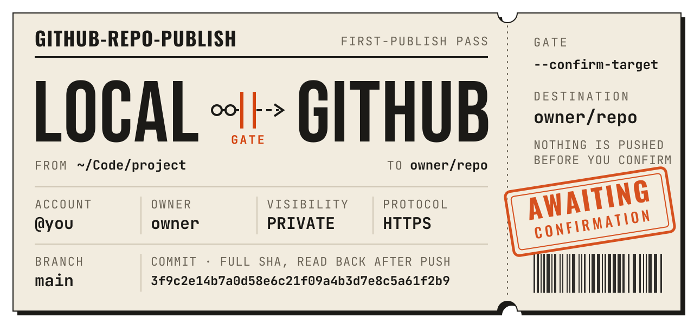
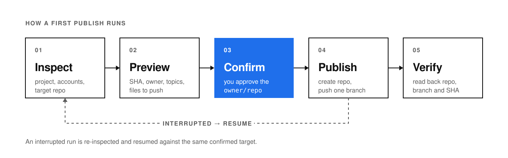

<picture>
  <source media="(prefers-color-scheme: dark)" srcset="assets/readme/hero-dark.svg">
  
</picture>

<p>
  <a href="#install">Install</a> ·
  <a href="#use">Use</a> ·
  <a href="#how-it-works">How it works</a> ·
  <a href="#requirements">Requirements</a> ·
  <a href="references/github.md">Operations guide</a>
</p>

---

## Overview

A portable [Agent Skill](https://agentskills.io/specification) for first-time publishing of local Git projects to GitHub. It previews the target and files to publish, drafts a description and topics for review, and verifies the pushed commit. Interrupted publishes can be resumed.

| | |
| :-- | :-- |
| **Use it for** | Publishing a local project to github.com for the first time, or finishing an interrupted first publish |
| **Targets** | A new repository, or an empty one you name explicitly — personal or organization, private or public |
| **Not for** | Pushing to repositories that already have branches or tags, or ongoing sync after the first publish |
| **Runs on** | macOS or Linux, with Git, GitHub CLI (`gh`), and Python 3.8+ |

## How it works

<picture>
  <source media="(prefers-color-scheme: dark)" srcset="assets/readme/workflow-dark.svg">
  
</picture>

- **Preview before anything leaves your machine.** The agent shows the platform, project path, branch and full SHA, account, owner, repository name, visibility, protocol, and the drafted description and topics — plus what it found when checking for credentials, large files, LFS, submodules, and push-triggered workflows.
- **Nothing is pushed without an explicit confirmation.** A suggested owner, a logged-in account, or the original request never counts as approval. You confirm the exact `owner/repo` after seeing the full preview.
- **Every publish is read back, and can be resumed.** After pushing, the script reads the repository and branch back from GitHub. If a run stops partway, the agent re-inspects and resumes the same confirmed target instead of starting over.

## Install

Copy the entire skill folder, including `SKILL.md`, `scripts/`, and `references/`, to a skills directory your agent reads. Name the copied folder `github-repo-publish`.

| Client | Project skill directory | How to start |
| --- | --- | --- |
| [Codex](https://learn.chatgpt.com/docs/build-skills#where-codex-loads-local-skills) | `.agents/skills/github-repo-publish/` | Invoke `$github-repo-publish` in chat. |
| [Claude Code](https://code.claude.com/docs/en/skills#choose-where-skills-load) | `.claude/skills/github-repo-publish/` | Run `/github-repo-publish`. |
| [Cursor](https://cursor.com/docs/skills#skill-directories) | `.agents/skills/github-repo-publish/` | Type `/` in Agent chat and select the skill. |
| [Gemini CLI](https://geminicli.com/docs/cli/skills/) | `.agents/skills/github-repo-publish/` | Check `/skills list` and ask Gemini to use the skill by name. |
| [OpenCode](https://opencode.ai/docs/skills/#discovery) | `.agents/skills/github-repo-publish/` | Ask OpenCode to load and use the skill by name. |

> [!TIP]
> The four clients that read `.agents/skills/` can share a single copy in the project. Other clients that support the Agent Skills format can load the same folder from their documented skills directory. `agents/openai.yaml` supplies optional interface metadata for Codex.

## Use

Run the agent where it can access the source project and an authenticated GitHub CLI session. Ask it to prepare a preview before it publishes:

```text
Use github-repo-publish to preview publishing this project. Suggest a description and topics, let me choose the owner and repository name, and wait for my confirmation.
```

After reviewing the preview, reply with the target it shows, for example:

```text
Confirm publish to owner/repo
```

<details>
<summary><b>More prompts</b></summary>

Dry run only — inspect and preview, then stop:

```text
Use github-repo-publish to inspect this project and show the publish preview. Do not publish.
```

Resume an interrupted publish:

```text
Use github-repo-publish to check the last publish of this project and resume it to the same confirmed target.
```

</details>

The skill uses the client's native question interface when available. For example, Codex can use structured questions and Claude Code can use `AskUserQuestion`. In a chat-only client, the same choices appear as text. The website is optional, and the complete preview is shown before you confirm the publish.

## Requirements

| | |
| :-- | :-- |
| **Platform** | macOS or Linux |
| **Tools** | Git, Python 3.8+, and a recent [GitHub CLI](https://cli.github.com/) |
| **Authentication** | One or more accounts logged in with `gh`; credentials stay in GitHub CLI |
| **Push protocol** | HTTPS by default, or SSH — including an existing local SSH alias for the chosen account |

It uses the GitHub account you select, with SSH or HTTPS for the push. See the [GitHub operations guide](references/github.md) for authentication, command details, [resuming an interrupted publish](references/github.md#中断恢复), and how to [record trial publishes](references/github.md#三次真实发布的记录方法).
