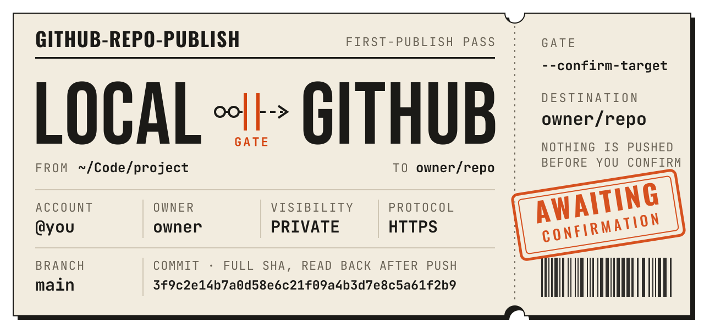
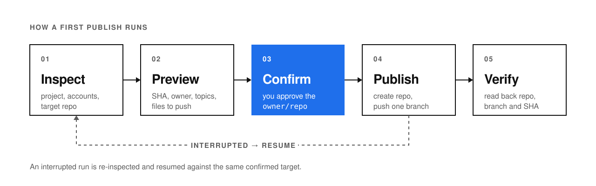

[English](README.md) · **简体中文**

<picture>
  <source media="(prefers-color-scheme: dark)" srcset="assets/readme/hero-dark.svg">
  
</picture>

[](LICENSE)
[](#安装)
[](#运行要求)
[](references/github.md)

[安装](#安装) · [使用](#使用) · [工作流程](#工作流程) · [运行要求](#运行要求) · [操作手册](references/github.md) · [许可证](#许可证)

---

## 项目简介

这是一个可在多个 Agent 客户端使用的 [Agent Skill](https://agentskills.io/specification)，用于把本地 Git 项目首次发布到 GitHub。它会预览目标仓库和要发布的文件，拟好简介和 Topics 供你筛选，并在推送后核对远端提交。发布中断后可以恢复。

| 项目 | 说明 |
| --- | --- |
| 适用场景 | 首次发布本地项目，或恢复一次中断的首次发布 |
| 目标仓库 | 新建仓库，或你明确指定的空仓库。支持个人或组织、公开或私有 |
| 范围 | 面向首次发布。已有分支或标签的仓库，以及后续日常同步，请使用常规 Git 流程 |
| 运行环境 | macOS 或 Linux，使用 Git、GitHub CLI（`gh`）和 Python 3.8+ |

## 工作流程

<picture>
  <source media="(prefers-color-scheme: dark)" srcset="assets/readme/workflow-dark.svg">
  
</picture>

- **先预览。** Agent 会展示项目路径、登录账号、仓库归属与名称、可见性、推送协议、分支、完整提交 SHA，以及简介和 Topics 草稿。它也会检查拟发布内容中的凭据、大文件、LFS、子模块及推送会触发的工作流。
- **由你确认。** 看完预览后，确认要发布到的 `owner/repo`。建议的仓库名和已登录的账号只用于准备方案。
- **推送后核验。** 脚本从 GitHub 读回仓库和分支，核对实际推送的提交。若中途失败，可以检查状态并从同一个目标恢复。

## 安装

将完整的 skill 文件夹复制到客户端会读取的目录，保留 `SKILL.md`、`scripts/` 和 `references/`。复制后的文件夹命名为 `github-repo-publish`。

| 客户端 | 项目中的安装目录 | 如何调用 |
| --- | --- | --- |
| [Codex](https://learn.chatgpt.com/docs/build-skills#where-codex-loads-local-skills) | `.agents/skills/github-repo-publish/` | 在聊天中调用 `$github-repo-publish` |
| [Claude Code](https://code.claude.com/docs/en/skills#choose-where-skills-load) | `.claude/skills/github-repo-publish/` | 输入 `/github-repo-publish` |
| [Cursor](https://cursor.com/docs/skills#skill-directories) | `.agents/skills/github-repo-publish/` | 在 Agent 聊天中输入 `/` 并选择该 skill |
| [Gemini CLI](https://geminicli.com/docs/cli/skills/) | `.agents/skills/github-repo-publish/` | 用 `/skills list` 确认已加载，再按名称调用 |
| [OpenCode](https://opencode.ai/docs/skills/#discovery) | `.agents/skills/github-repo-publish/` | 让 OpenCode 按名称加载并使用该 skill |

> [!TIP]
> 支持 `.agents/skills/` 的客户端可共用项目里的同一份 skill。其他兼容 Agent Skills 规范的客户端可以按各自的文档安装。`agents/openai.yaml` 为 Codex 提供可选的界面配置。

## 使用

在 Agent 能访问项目文件，且 GitHub CLI 已登录的环境中，先请它生成发布预览。

```text
用 github-repo-publish 预览当前项目的发布方案。请拟好简介和 Topics，让我选仓库归属和名称，等我确认后再发布。
```

核对预览后，回复实际的仓库归属和名称。

```text
确认发布到 owner/repo
```

<details>
<summary><b>更多提示词</b></summary>

只检查和预览

```text
用 github-repo-publish 检查这个项目并展示发布预览，到预览为止。
```

恢复中断的发布

```text
用 github-repo-publish 检查这个项目上一次发布的状态，并恢复到原来确认过的目标。
```

</details>

客户端支持原生提问框时，skill 会用它收集选择。例如 Codex 的结构化提问和 Claude Code 的 `AskUserQuestion`。也可以在聊天里回答同样的选项。Website 可留空，发布前会展示完整方案供你确认。

## 运行要求

| 项目 | 要求 |
| --- | --- |
| 平台 | macOS 或 Linux |
| 工具 | Git、Python 3.8+ 和新版 [GitHub CLI](https://cli.github.com/) |
| 登录 | 通过 `gh` 登录至少一个 GitHub 账号，凭据由 GitHub CLI 管理 |
| 推送协议 | SSH 或 HTTPS。可使用已配置的 SSH 别名，未指定且 `gh` 未配置时建议 HTTPS |

登录方式和具体命令见 [GitHub 操作手册](references/github.md)。手册也介绍了如何[恢复中断的发布](references/github.md#中断恢复)和[记录试用结果](references/github.md#三次真实发布的记录方法)。

## 许可证

项目采用 [MIT 许可证](LICENSE)。
