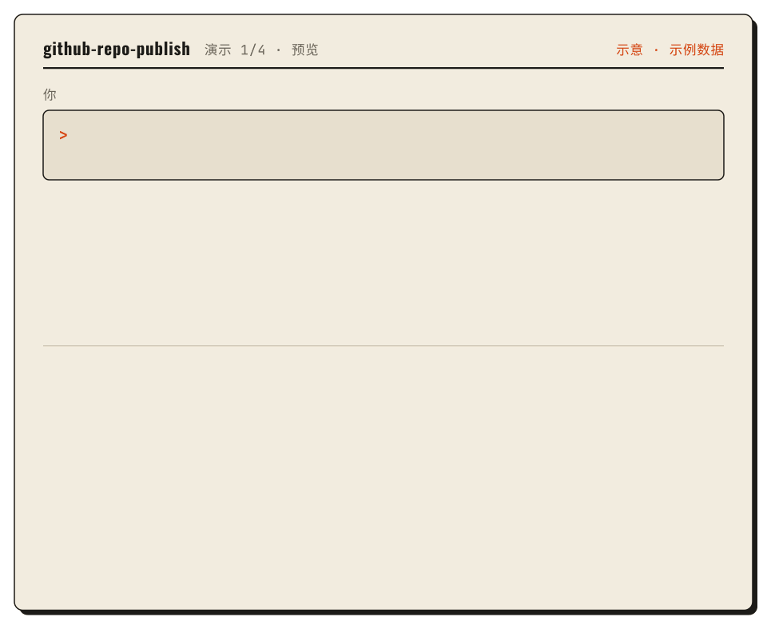
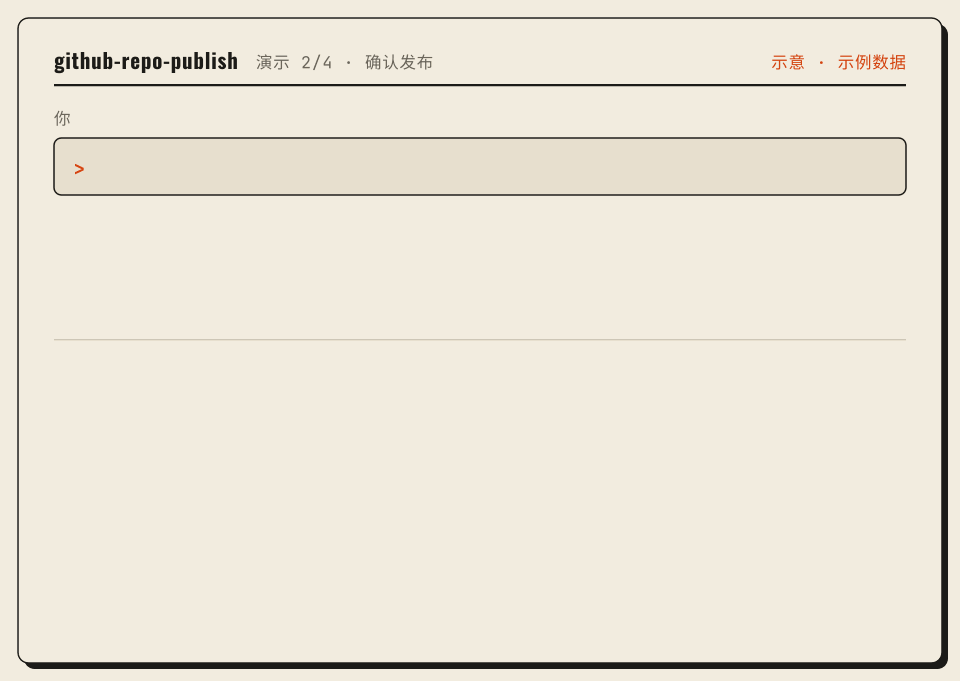
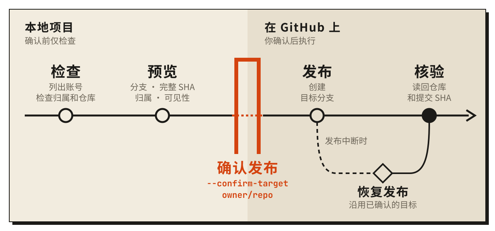
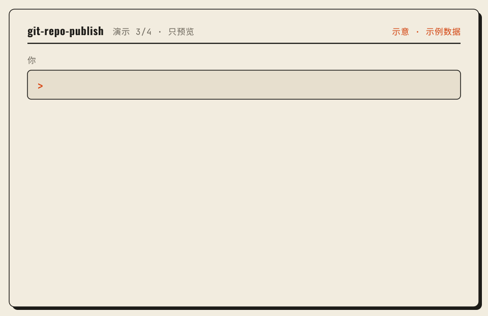
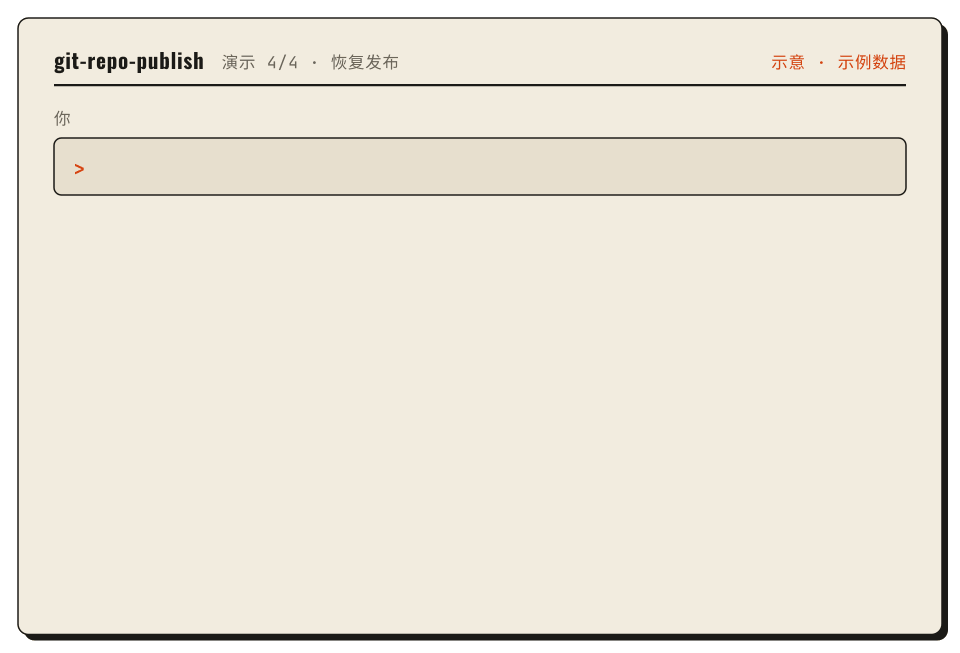

[English](README.md) · **简体中文**

# git-repo-publish

把本地 Git 项目首次发布到 GitHub 或云效 Codeup 的 [Agent Skill](https://agentskills.io/specification)。

<picture>
  <source media="(prefers-color-scheme: dark)" srcset="assets/readme/zh-CN/publish-preview-dark.svg">
  
</picture>

[安装](#安装) · [首次发布](#使用) · [工作流程](#工作流程) · [配置 Codeup](#配置-codeup) · [运行要求](#运行要求) · [MIT 许可证](LICENSE)

## 安装

最新版 Skills CLI 需要 Node.js 22.20 或更新版本，以及 npm。

```sh
npx skills add \
  byteee-com/git-repo-publish-skill \
  --skill git-repo-publish --global
```

按提示选择客户端。`--global` 让 skill 在多个项目中可用，省略它则安装到当前项目。 [Skills CLI 参数](https://github.com/vercel-labs/skills/blob/main/docs/commands.md#skills-add)

<details>
<summary>各客户端的调用方式</summary>

| 客户端 | 如何调用 |
| --- | --- |
| [Codex](https://learn.chatgpt.com/docs/build-skills) | 在聊天中输入 `$git-repo-publish` |
| [Claude Code](https://code.claude.com/docs/en/skills) | 输入 `/git-repo-publish` |
| [Cursor](https://cursor.com/docs/skills) | 在 Agent 聊天中输入 `/` 并选择 `git-repo-publish` |
| [Gemini CLI](https://geminicli.com/docs/cli/skills/) | 用 `/skills list` 确认已加载，再按名称调用 |
| [OpenCode](https://opencode.ai/docs/skills/) | 让 OpenCode 使用 `git-repo-publish` |

</details>

## 使用

### 连接 GitHub

第一次配置时，运行下列命令，按提示生成或上传 SSH 公钥。测试连接后，核对 GitHub 返回的用户名是不是你要用于发布的账号。 [GitHub CLI 登录说明](https://cli.github.com/manual/gh_auth_login) · [SSH 连接测试](https://docs.github.com/en/authentication/connecting-to-github-with-ssh/testing-your-ssh-connection)

```sh
gh auth login --hostname github.com --web --git-protocol ssh
ssh -T git@github.com
```

首次连接 SSH 时，先与 GitHub 公布的主机指纹核对一致，再接受。 [GitHub SSH 主机指纹](https://docs.github.com/en/authentication/keeping-your-account-and-data-secure/githubs-ssh-key-fingerprints)

SSH 已配好、只缺 `gh` 登录时，运行 `gh auth login --hostname github.com --web --skip-ssh-key`。使用多个账号时，可以告诉 skill 要用哪个 GitHub 账号和已有的 SSH 别名。发布前，skill 会核对 SSH 登录身份是否与所选账号一致。也可以明确指定 HTTPS。 [GitHub 操作手册](references/github.md)

### 预览并确认

用客户端打开要发布的项目，在聊天中输入。

```text
用 git-repo-publish 预览当前项目的发布方案。请拟好简介和 Topics，让我选仓库归属和名称，等我确认后再发布。
```

客户端支持原生提问框时，skill 会用它收集选择。例如 Codex 的结构化提问和 Claude Code 的 `AskUserQuestion`。也可以在聊天里回答同样的选项。Website 可留空，发布前会展示完整方案供你确认。

核对预览里的账号、目标、可见性、分支及拟发布的文件或提交。GitHub 新仓库默认 **私有**，推送默认走 **SSH**。确认时填入预览中的实际目标。

```text
确认发布到 owner/repo
```

<details>
<summary>查看预览与确认演示</summary>

仓库名和提交 SHA 均为示例值。预览演示使用可选的 HTTPS 推送。 [静态版本](assets/readme/demo/)

<picture>
  <source media="(prefers-color-scheme: dark)" srcset="assets/readme/demo/gif/preview-zh-CN-dark.gif">
  
</picture>

<picture>
  <source media="(prefers-color-scheme: dark)" srcset="assets/readme/demo/gif/confirm-zh-CN-dark.gif">
  
</picture>

</details>

## 工作流程

<picture>
  <source media="(prefers-color-scheme: dark)" srcset="assets/readme/workflow-zh-CN-dark.svg">
  
</picture>

1. **检查项目和目标。** 核对 Git 根目录、分支、提交和拟发布文件，检查凭据、大文件、LFS、子模块及推送触发的工作流。项目还没有提交时，先预览首个提交拟包含的文件。远端可以新建，也可以复用你明确指定的空仓库。
2. **按确认的方案发布。** 你确认目标和预览后，skill 创建或复用仓库，推送选定分支，并按平台能力写入选定的简介、Topics 和网站。
3. **回读远端结果。** Skill 核对远端分支和完整提交 SHA，返回仓库链接。中断时可检查已保存的状态，再继续同一次发布。 [发布验证与恢复](references/github.md#中断恢复)

<details>
<summary>只预览和中断恢复的提示词</summary>

**只检查和预览**

```text
用 git-repo-publish 检查这个项目并展示发布预览，到预览为止。
```

<picture>
  <source media="(prefers-color-scheme: dark)" srcset="assets/readme/demo/gif/dry-run-zh-CN-dark.gif">
  
</picture>

**恢复中断的发布**

```text
用 git-repo-publish 检查这个项目上一次发布的状态，并恢复到原来确认过的目标。
```

<picture>
  <source media="(prefers-color-scheme: dark)" srcset="assets/readme/demo/gif/resume-zh-CN-dark.gif">
  
</picture>

</details>

## 托管平台

| 平台 | 可见性 | 推送协议 |
| --- | --- | --- |
| [GitHub](references/github.md)，个人或组织仓库 | 私有或公开 | 默认 SSH，可选 HTTPS |
| [云效 Codeup](references/codeup.md)，中心版，组织或代码组仓库 | 私有或组织内公开 | HTTPS |

GitLab 和 Gitee 计划后续支持。已有分支或标签的仓库，以及后续日常同步，请使用常规 Git 流程。

### 配置 Codeup

<details>
<summary>创建 Codeup 配置档并预览发布</summary>

在已安装的 skill 目录里，用组织 ID、完整父路径和 HTTPS 克隆账号创建配置档。

```sh
python3 scripts/codeup_publish.py configure --profile work \
  --organization-id 你的组织ID \
  --namespace 组织路径/team --username 你的克隆账号
python3 scripts/codeup_publish.py config --profile work
```

通过密码管理器或隐藏输入，在终端里设置 `CODEUP_TOKEN`。配置档保存在项目仓库外，只包含非敏感字段。 [Codeup 令牌权限和恢复流程](references/codeup.md)

```text
用 git-repo-publish 预览把当前项目发布到 Codeup。
使用 work 配置档，目标为 组织路径/team/my-project，私有。
展示完整方案后等我确认，再创建仓库和推送。
```

</details>

## 运行要求

| 项目 | 要求 |
| --- | --- |
| 运行环境 | macOS 或 Linux、Git、Python 3.8+ |
| 安装工具 | 包含 npm 和 `npx` 的 Node.js 22.20+ |
| GitHub 认证 | 新版 GitHub CLI（`gh`），走 SSH 时还需对应账号的 SSH 密钥 |
| Codeup 认证 | 配置档，以及通过环境变量提供的个人访问令牌 |

[GitHub 操作手册](references/github.md) · [Codeup 操作手册](references/codeup.md) · [记录试用结果](references/github.md#三次真实发布的记录方法)

## 许可证

项目采用 [MIT 许可证](LICENSE)。
